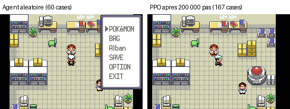
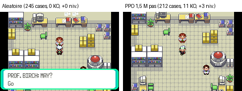

# Pokémon Émeraude : apprentissage par renforcement

Un agent entraîné **de zéro** par apprentissage par renforcement (PPO) à jouer à Pokémon Émeraude (GBA), piloté depuis Python via l'émulateur mGBA, sur GPU.

> **Statut : projet en cours.** L'infrastructure complète est en place et validée (émulation, lecture de la mémoire du jeu, environnement Gymnasium, entraînement PPO sur GPU). Première étape atteinte : l'agent apprend à se déplacer (Rosyères atteinte après 200 000 pas) puis, avec des épisodes de 2 048 pas, à combattre (~15 Pokémon sauvages mis KO et 3 à 4 niveaux par épisode, sans perdre de Pokémon). Il n'explore pas encore au-delà de la Route 101 (voir [Résultats](#résultats)).

## Objectif

Aller **le plus loin possible** dans le jeu avec un agent qui part de zéro, guidé uniquement par une fonction de récompense écrite à la main.

Par étapes :

1. **Première étape** : démontrer un apprentissage net par rapport à un agent aléatoire (courbe TensorBoard, GIF avant/après).
2. **Ensuite** : enrichir la récompense et allonger l'horizon (épisodes plus longs, points de départ plus avancés) pour progresser dans le scénario : combats, niveaux, badges.

L'intérêt du projet est autant dans la conception de la récompense (*reward shaping*) que dans l'ingénierie qui l'entoure : compilation d'un émulateur depuis les sources, lecture de la RAM du jeu, environnement reproductible, entraînement sur GPU.

## Architecture

```
ROM + sauvegarde ──► mGBA (bindings Python) ──► pygba ──► Gymnasium (PyGBAEnv)
                          │                        │              │
                          │                        └── lecture de la RAM (équipe, position, badges...)
                          │                                       │
                          └── instantané mémoire (reset rapide)   ▼
                                                      Stable-Baselines3 (PPO, CnnPolicy, GPU)
```

| Fichier | Rôle |
|---|---|
| `pokemon_loader.py` | Charge la ROM et la sauvegarde, puis passe l'intro jusqu'au point de départ |
| `rewards.py` | Fonction de récompense : base de pygba + bonus d'exploration |
| `train.py` | Entraînement PPO sur plusieurs émulateurs en parallèle, avec checkpoints et suivi TensorBoard |
| `scripts/` | Scripts de validation et de diagnostic : état du jeu, instantanés, environnement, ligne de base aléatoire, décomposition de la récompense, GIF avant/après |

### Choix de conception

- **Observation** : l'écran du jeu, image `(240, 160, 3)`.
- **Actions** : 35 actions discrètes (5 choix de flèche × 7 choix de bouton, combinables).
- **Un pas = 24 frames** (`frameskip=23`), ce qui est suffisant pour qu'une action ait un effet visible dans le jeu.
- **Point de départ fixe** : on joue l'intro une fois, puis chaque épisode repart d'un **instantané de l'émulateur en mémoire** (`save_raw_state` / `load_raw_state`). Le reset est instantané au lieu de rejouer ~3000 frames d'intro.
- **Récompense** : la récompense de base de pygba (badges, Pokédex, dresseurs battus, expérience, événements de scénario) plus nos règles (`rewards.py`) : +0,01 par case nouvelle, +1 par carte extérieure nouvelle (+0,2 en intérieur), +1 par niveau gagné, +2 par évolution, +0,5 par adversaire entièrement entamé (au prorata des dégâts) et +1 par KO adverse, et des pénalités de santé (PV manquants, KO, statuts). Comme pygba, nos règles forment un score dont on récompense la variation : se soigner rapporte ce que les dégâts ont coûté. Toutes les règles envisagées, avec leur statut, sont dans [docs/regles_recompense.md](docs/regles_recompense.md).
- **Parallélisme** : `SubprocVecEnv`, un émulateur par processus. Chaque processus charge sa ROM, prend son propre instantané de départ et a sa propre récompense (donc son propre ensemble de cases visitées). Le lot par mise à jour vaut `n_steps × envs` (512 × 8 = 4096 pas par défaut).
- **`info` allégé** : pygba renvoie tout l'état du jeu à chaque pas ; `ExplorationEmerald` ne renvoie que ses compteurs (cases, cartes, niveaux, évolutions, dégâts et KO adverses, KO, statuts, PV manquants), pour ne pas faire transiter ce gros dictionnaire entre processus. Chaque compteur est tracé dans TensorBoard (`rollout/<nom>`).

## Installation (Windows)

Testé avec Python 3.11, une RTX 5070 Ti et Windows.

### 1. Environnement Python

```powershell
python -m venv venv
venv\Scripts\activate
```

La RTX 50xx (architecture Blackwell) demande une version récente de PyTorch. J'ai utilisé un build **nightly CUDA 12.8** :

```powershell
pip install --pre torch --index-url https://download.pytorch.org/whl/nightly/cu128
pip install gymnasium stable-baselines3 tensorboard pillow cffi pygba
```

### 2. mGBA avec bindings Python

Le paquet `mgba` n'est pas disponible en roue pour Windows : il faut compiler **mGBA depuis les sources**. J'ai utilisé le fork [`hanzi/libmgba-py`](https://github.com/hanzi/libmgba-py) avec Visual Studio (charge de travail « Développement Desktop en C++ »), CMake et vcpkg (géré par le script du fork).

Points qui m'ont coûté du temps :

- **Compiler sur un disque NTFS.** Sur un SSD externe en exFAT, l'extraction des archives de vcpkg échoue (`Can't restore time`).
- **CMake 4.x** refuse certains projets anciens : définir `CMAKE_POLICY_VERSION_MINIMUM=3.5` avant de lancer le script.
- **FFmpeg** (version trop récente) est incompatible avec mGBA 0.10.2 : ajouter `-DUSE_FFMPEG=OFF` à la ligne `cmake` de `build_win64.bat`.
- **Lua** (version trop récente) provoque des erreurs de liaison : ajouter `-DENABLE_SCRIPTING=OFF`.
- Après le build, copier `build\win64\mgba` dans le projet et installer `cffi` (module `_cffi_backend`).

Les fichiers `.dll` et `.pyd` produits sont ignorés par Git (`.gitignore`) : ils se régénèrent avec le script de build.

### 3. ROM et sauvegarde

Aucune ROM n'est fournie dans ce dépôt. Il faut disposer de sa propre copie du jeu.

- **La version USA (code `BPEE`) est nécessaire.** Les adresses mémoire utilisées par pygba sont celles de cette version : avec la version française (`BPEF`), la lecture de la mémoire plante.
- Placer la ROM dans `roms/`.
- Créer une sauvegarde de départ en jouant dans mGBA (choix du starter, puis sauvegarde **dans le jeu**, pas un *save state*), et la copier sous `roms/start_save.sav`.

Ne pas commiter ces fichiers : `*.gba` et `*.sav` sont déjà dans le `.gitignore`.

## Utilisation

```powershell
venv\Scripts\activate

# Vérifier la ligne de base d'un agent aléatoire (~7 min)
python -m scripts.test_random_baseline

# Test court du montage (~1 min) : checkpoints et TensorBoard
python train.py --pas 8192 --envs 4 --checkpoint 4096 --nom test_court

# Entraînement PPO : 200 000 pas, 8 émulateurs (checkpoints dans checkpoints/, courbes dans runs/)
python train.py
python train.py --episode 2048 --nom long   # options : --pas, --envs, --episode, --nom, --checkpoint, --lr, --entropie

# Suivre l'entraînement dans un second terminal
tensorboard --logdir runs
```

Les scripts de `scripts/` se lancent **depuis la racine** avec `python -m scripts.<nom>` : les imports (`pokemon_loader`, `rewards`, `mgba`) et les chemins `roms/` et `diag/` sont relatifs à la racine.

Les logs d'mGBA sont coupés dans `train.py` par `mgba.log.silence()` (dans chaque processus). Les anciens scripts de `scripts/` ne le font pas : rediriger leur sortie si besoin (`> sortie.txt 2>&1`).

## Résultats



| Mesure | Valeur |
|---|---|
| Vitesse d'entraînement, 1 environnement | ~58 pas/s (PPO sur GPU inclus) |
| Vitesse d'entraînement, 4 / 8 / 12 environnements | ~115 / ~200 / ~270 pas/s (16 cœurs logiques) |
| Agent **aléatoire**, 40 épisodes de 512 pas | récompense moyenne 0,609 ± 0,226, soit ~62 cases visitées |
| PPO, 20 480 pas, 1 environnement | récompense moyenne finale 0,67 (dans le bruit) |
| **PPO, 200 000 pas, 8 environnements** (12,6 min) | récompense moyenne **0,62 → 6,52**, cases visitées **63 → 183** |

**Courbe d'apprentissage** (`rollout/ep_rew_mean`, moyenne sur les derniers épisodes) :

| Pas | 4 k | 40 k | 60 k | 100 k | 140 k | 160 k | 200 k |
|---|---|---|---|---|---|---|---|
| Récompense | 0,62 | 0,66 | 0,82 | 1,59 | 2,60 | 3,83 | 6,52 |
| Cases visitées | 63 | 79 | 124 | 141 | 144 | 167 | 183 |

**D'où vient la récompense ?** Décomposition sur 3 épisodes de l'agent final (`scripts/decomposer_recompense.py`) :

| Source | Par épisode |
|---|---|
| Nouvelle ville (Rosyères) | +5 |
| Exploration | ~1,7 (~170 cases) |
| Pokémon sauvages vus | 0,2 à 0,4 |
| Flags de script, dresseurs, expérience | 0 |

L'agent a donc appris un vrai trajet (maison → Bourg-en-Vol → Route 101 → Rosyères → Route 103), et non une faille de la récompense. Limites : il **fuit les combats** (aucune expérience gagnée), et `approx_kl` reste élevé (0,15 à 0,3) : les mises à jour de PPO sont fortes, à surveiller si l'entraînement devient instable.

### Lot 1 de règles (niveaux, cartes, santé), 512 pas par épisode

| Mesure | Référence (exploration seule) | Lot 1 |
|---|---|---|
| Cases visitées en fin de run | 183 | 138 |
| Carte la plus lointaine | Route 103 (après Rosyères) | Route 101 |
| Niveaux gagnés, KO, PV perdus | 0 | 0 |

Le lot 1 fait **moins bien** : l'agent atteint la Route 101 (+1 par carte extérieure) puis plafonne dès 120 000 pas, et il fuit toujours les combats, donc les règles de niveaux et de santé ne se déclenchent jamais. Deux pistes, à départager :

- **PPO se fige trop tôt** : `approx_kl` reste entre 0,15 et 0,25 (il devrait être autour de 0,01 à 0,03). Les mises à jour sont trop fortes et la politique cesse d'explorer. Correctifs : taux d'apprentissage plus bas, bonus d'entropie (`ent_coef`).
- **Une seule graine par run** : l'écart entre deux runs identiques n'est pas encore mesuré, il peut être du même ordre que l'écart observé ici.

**Relance avec un taux d'apprentissage de 1e-4 et un bonus d'entropie de 0,01** (nouveaux défauts de `train.py`) : `approx_kl` redescend à 0,02 à 0,07, mais le comportement est le même (récompense 3,05, Route 101, aucun combat gagné). Le blocage vient donc de la récompense : sur 512 pas, fuir est rentable, car un combat coûte des pas et des PV et ne rapporte presque rien avant plusieurs victoires. Piste suivante : récompenser les dégâts infligés à l'adversaire.

**Avec la récompense des dégâts infligés** (+0,5 par adversaire entier, +1 par KO) : même plateau (3,13, Route 101), dégâts quasi nuls (0 à 0,08 adversaire par épisode). En 512 pas, l'agent rencontre trop peu de combats pour découvrir qu'attaquer rapporte. Piste suivante : épisodes de 2 048 pas.

### Épisodes de 2 048 pas : l'agent combat

Même récompense, épisodes 4 fois plus longs (`--episode 2048`), 331 776 pas en ~21 min :

| Pas | 20 k | 120 k | 185 k | 250 k | 315 k | 332 k |
|---|---|---|---|---|---|---|
| Récompense | 2,92 | 4,90 | 5,68 | 8,51 | 13,3 | 14,7 |
| KO adverses / épisode | 0 | 1 | 3,5 | 6,6 | 10,4 | 10,4 |
| Niveaux gagnés / épisode | 0 | 0,5 | 1,1 | 2 | 2,75 | 2,6 |
| KO subis / épisode | 0 | 0 | 0 | 0,1 | 0 | 0 |

À partir de ~120 000 pas, l'agent **apprend à combattre** : une dizaine de Pokémon sauvages mis KO et près de 3 niveaux gagnés par épisode, presque sans perdre de Pokémon. La récompense monte encore à la fin : le run n'a pas convergé. L'exploration, elle, ne progresse plus (2 cartes extérieures) : l'agent reste combattre dans les hautes herbes.

Le run s'est arrêté à 331 776 pas sur un plantage de pygba : une espèce invalide lue dans l'équipe (probablement pendant que le jeu la réécrit). Corrigé dans `rewards.py` : ces pas sont ignorés, ce qui évite aussi de compter une fausse évolution.

### Jusqu'à 1,5 million de pas



Reprise du run précédent (`--reprendre`) jusqu'à 1 million de pas (40 min), puis 500 000 pas avec un bonus de +3 au lieu de +1 par nouvelle carte extérieure (`--carte-ext 3`, 30 min). Aucun plantage.

| Pas | 330 k | 500 k | 700 k | 1 M | 1,5 M |
|---|---|---|---|---|---|
| Récompense | 14,7 | 26,1 | 29,9 | ~29 | 31,0 |
| KO adverses / épisode | 10,4 | 13,2 | ~14 | ~14 | 13,1 |
| Niveaux gagnés / épisode | 2,6 | 3,25 | ~3,4 | ~3,3 | 3,1 |
| Cartes extérieures | 2 | 2 | 2 | 2 | 2 |

Décomposition sur 3 épisodes de l'agent final (2 048 pas) : 14 à 17 KO adverses (+14 à +17), 7 à 9 adversaires entamés (+7 à +9), 3 à 4 niveaux (+3 à +4), exploration ~1,5, PV manquants −0,2 à −0,3, **aucun Pokémon perdu**.

**Lecture :** le combat est appris et plafonne dès ~700 000 pas. En revanche l'agent reste sur la Route 101 : le bonus de +3 par route n'a rien changé, car une politique installée dans le combat ne découvre jamais la route suivante, et un bonus jamais vu n'apprend rien. Pistes : départs variés (instantanés pris plus loin dans le jeu), ou bonus d'exploration qui ne s'épuise pas avec le temps (cases nouvelles à l'échelle de tout l'entraînement plutôt que de l'épisode).

## Problèmes rencontrés et enseignements

- **Version de la ROM.** Le wrapper pygba plantait sur la ROM française. Un diagnostic simple (lecture du code du jeu dans l'en-tête et d'une table connue en ROM) a confirmé que les adresses étaient celles de la version USA.
- **Chargement de la sauvegarde.** `autoload_save()` retournait `False` dans ma compilation de mGBA. Contournement : charger le fichier explicitement avec `core.load_save(vfile)` (voir `pokemon_loader.py`).
- **Captures d'écran.** La fonction `save_png` du fork est cassée (incohérence d'arguments avec la bibliothèque C). Contournement : `to_pil()` puis conversion en RGB avant d'enregistrer avec Pillow.
- **Récompense rare.** Sans signal, PPO n'apprend rien : d'où le bonus d'exploration. Il plafonne cependant avec la taille de la zone accessible.

## Feuille de route

- [x] Environnement GPU (PyTorch nightly CUDA 12.8)
- [x] Compilation de mGBA et bindings Python
- [x] Lecture de l'état du jeu (équipe, position, badges, Pokédex)
- [x] Environnement Gymnasium avec reset instantané
- [x] Ligne de base aléatoire
- [x] Premier entraînement PPO (sans preuve d'apprentissage)
- [x] Plusieurs environnements en parallèle (un émulateur par processus)
- [x] Run de 200 000 pas avec suivi TensorBoard : apprentissage net (Rosyères atteinte)
- [x] Épisodes de 2 048 pas : l'agent apprend à combattre
- [x] Reprise depuis un checkpoint (`--reprendre`)
- [ ] Combiner combat et exploration : points de départ plus avancés, ou bonus d'exploration global
- [x] Récompenses plus riches, lot 1 : santé de l'équipe (PV, KO), statuts, évolutions, nouvelles cartes (voir [docs/regles_recompense.md](docs/regles_recompense.md))
- [ ] Lecture du sac (déjà possible avec pygba) puis de l'état de combat (adresses mémoire à identifier)
- [x] GIF avant/après entraînement

## Remerciements

- [mGBA](https://mgba.io/) pour l'émulateur et [`hanzi/libmgba-py`](https://github.com/hanzi/libmgba-py) pour les bindings Python.
- [`dvruette/pygba`](https://github.com/dvruette/pygba) pour le wrapper Gymnasium et la lecture de la mémoire de Pokémon Émeraude.
- [Stable-Baselines3](https://github.com/DLR-RM/stable-baselines3) et [Gymnasium](https://gymnasium.farama.org/).
- Projet inspiré par les travaux de Peter Whidden sur l'apprentissage par renforcement appliqué à Pokémon.

Pokémon est une marque de Nintendo, Game Freak et Creatures Inc. Ce projet est un travail personnel sans lien avec ces sociétés.
